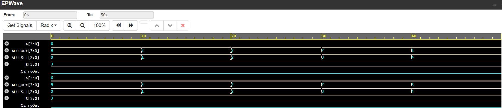

# 4-Bit Arithmetic Logic Unit (ALU) in Verilog

This repository contains the Verilog RTL design and testbench for a **4-Bit ALU** capable of performing basic arithmetic and bitwise logical operations. Simulated and verified using **Icarus Verilog** on EDA Playground.

## Operations Supported

| `ALU_Sel` | Operation | Description |
| :--- | :--- | :--- |
| `000` | Addition | `A + B` (with `CarryOut`) |
| `001` | Subtraction | `A - B` |
| `010` | Bitwise AND | `A & B` |
| `011` | Bitwise OR | `A | B` |
| `100` | Bitwise XOR | `A ^ B` |

## Simulation Waveform

